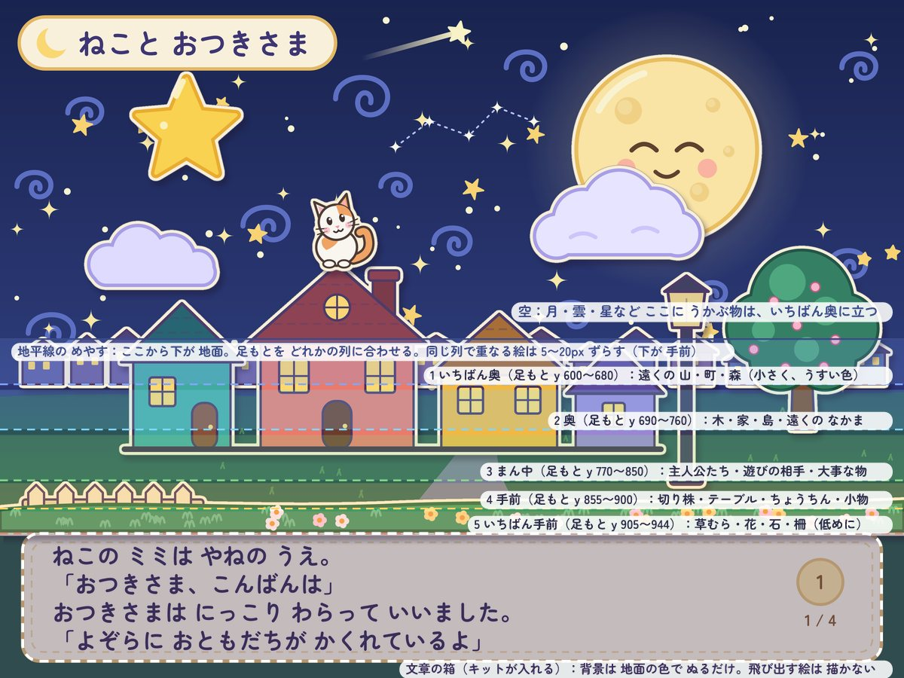

# 03 絵を用意する

絵は2つの方法で用意できます。**1ページの中で混ぜてもかまいません。**

| | A. PNG | B. SVG |
|---|---|---|
| どうやって描く | お絵かきアプリ（CLIP STUDIO PAINT・Procreate・アイビスペイントなど） | Claude などにプログラムで描いてもらう／Illustrator・Inkscape などのベクターアプリ |
| ファイル | `cat.png` | `cat.svg` |
| 見本 | `books/sample-svg` の絵を、同じ名前の `.png` に置きかえる | `books/sample-svg` |
| 開くと | 画像として見られる | ブラウザで絵として見られる（中身は文字） |

どちらも `pages/<ページ>/layers/` に入れます。`cat.png` と `cat.svg` のように、同じ名前で2つ置くことはできません。

## 1. どちらにも共通のきまり

### ページ全体の大きさで、1つずつ

- **1ファイル = ページ全体（縦横の比 4:3）**。飛び出す絵も、ページの中でその絵がある位置に描き、まわりは透明にします
- こうしておくと、すべての絵がぴったり重なります。切り抜いたり、位置を合わせたりする作業はいりません
- 下の約 5分の1（上から 79% より下）には **文章の箱** が自動で入ります。ここには背景の色だけ塗っておけば OK

### ファイルの名前

| ファイル | 中身 |
|---|---|
| `_background.png`（.svg） | 紙に残る絵：空・地面・遠くの景色など。**飛び出す絵は描かない** |
| `cat.png`、`tree.svg` … | 飛び出す絵を1つずつ。**まわりは透明** |
| `moon@awake.svg` | さわったときに切りかわる絵（`moon` と同じ位置に描く） |
| `cat@happy.svg` | 登場人物の笑顔（クリアしたときに自動で切りかわる。下の「表情の絵」） |
| `cat@blink.svg`・`cat@talk.svg` | まばたき・しゃべる口（あると自動で使う。下の「顔のパーツ」で自動で作れる） |
| `window@on.svg` | 明かりがついた窓やランプ（`light` で使う。なくても光る） |
| `box@open.svg` | 開いた箱（`reveal` で中から何か出てくるときに使う。なくても出てくる） |
| `rabbit.png`（かくれている） | 最初は見えず、見つけると出てくる絵 |

- `@` の前の名前（＝ id）は **半角の英数字**にします（`cat`、`tree2`、`house_red` など）
- 印刷される紙は「背景 ＋ 文章 ＋ 飛び出す絵（かくれているもの以外）」を重ねた絵になります。紙だけで読んでも成り立つ絵にしておくと安心です

### page.json に並べる

```json
"pieces": [
  { "id": "star" },
  { "id": "moon" },
  { "id": "rabbit", "hidden": true },
  { "id": "cloud" },
  { "id": "houses" },
  { "id": "cat", "parent": "houses" },
  { "id": "owl", "parent": "tree", "hidden": true, "behind": true },
  { "id": "tree" },
  { "id": "hill" }
]
```

- **上に書いたものほど奥**、下に書いたものほど手前になります（紙の上の方＝奥、下の方＝手前に置くと自然です）
- `"hidden": true` … 最初はかくれている（印刷にも出ない）
- `"parent": "houses"` … 屋根の上のネコのように、ほかの絵の上に乗っているもの。乗っている絵と一緒に立ち上がります
- `"behind": true` … parent のうしろにかくれる（木のうしろから出てくるふくろう など）
- `"pivot"` … 立ち上がるときの折り目。ふつうは下（`"bottom"`）。吊り下がっているもの（風鈴・カーテン）は `"top"`、ドアのように横に開くものは `"left"`（左の はしで 折れる）か `"right"`（右の はしで 折れる）
- `"flat": true` … 立ち上がらず、紙の上にぺたっとあるもの（水たまりなど）
- `"idle"` … ずっと少しだけ動いている。`"float"`（ふわふわ うかぶ：雲・おばけ・風船）・`"breathe"`（すやすや いきをする：ねている動物）・`"sway"`（ゆらゆら ゆれる：草・花・ちょうちん）・`"fly"`（飛び回る：ほたる・ちょう・はち。自分の場所の前を、1つずつ ちがう輪を かいて飛ぶ）
- `"glow": true` … うしろが ぽわっと光って、ずっと ゆっくり点滅する（ほたる・星・ランプ）。さわったときの `"effect": "glow"` で、ぴかっと強く光る

ここに書くのは id だけです。`.png` か `.svg` かは書きません（自動で見つけます）。`@` の付いた切りかえの絵も書きません。

### 背景のひな形

背景を描かずに、キットの背景をそのまま使えます。`layers/_background` を置かずに、page.json に書きます。

```json
"background": "forest"
```

| 名前 | 背景 |
|---|---|
| `field` | はれた日の のはら（空・おひさま・くも・おか・草花） |
| `night` | よるの のはら（ほし・みかづき・おか） |
| `room` | おへや（かべ・まど・ゆか・じゅうたん） |
| `forest` | もりの なか（木・きのこ・草） |
| `sea` | うみべ（空・うみ・すなはま・かいがら） |
| `snow` | ゆきの のはら（ゆきやま・もみの木・ゆき） |

- どれも、カメラが見分けやすいように細かい模様を散らしてあります
- 少し描き足したいときは、`system/backgrounds/<名前>.svg` を `layers/_background.svg` にコピーして描き足します（`_background` があると、そちらが使われます）
- ページどうしが似すぎると見分けにくくなるので、同じひな形を続けて使うときは、描き足して変化をつけます

### 表情の絵

登場人物の表情は、次の名前にそろえます。元の絵（`cat.svg` など）をコピーして、**位置・大きさ・輪郭は同じまま、目や口だけ** 変えます。

| 名前 | 表情 | キットの使いかた |
|---|---|---|
| `<id>@happy` | うれしい・笑顔 | **ページをクリアすると、自動でこの絵になる**（[05 しかけ](05_しかけ.md) の done） |
| `<id>@surprise` | びっくり | swap などで使う |
| `<id>@sad` | かなしい・こまった | swap などで使う |
| `<id>@sleep` | ねている | swap などで使う |

| `<id>@blink` | 目をとじる | **ときどき自動で まばたきする**（元の絵のときだけ） |
| `<id>@talk` | 口をあける | **セリフの吹き出しが出ている間、自動で口が動く**（元の絵のときだけ） |

- `@happy` は、登場人物が出てくる **すべてのページ** の `layers/` に置きます（絵はページごとなので）。見本の `cat@happy.svg`・`rabbit@happy.svg`・`owl@happy.svg` を見てください
- これ以外の表情や動きの絵（`@cheer`・`@push` など）も、自由な名前で作れます

### 顔のパーツ（表情ツール）

SVG の登場人物は、目と口に しるし（`class`）を付けて描くと、表情の絵が **絵本を作るときに自動でできます**。

```svg
<ellipse class="eye" cx="48" cy="52" rx="6" ry="9" fill="#3b2a20"/>   <!-- 目の黒いところ -->
<circle class="shine" cx="50" cy="48" r="2.6" fill="#fff"/>           <!-- 目の白い光（なくても OK） -->
<ellipse class="eye" cx="76" cy="52" rx="6" ry="9" fill="#3b2a20"/>
<circle class="shine" cx="78" cy="48" r="2.6" fill="#fff"/>
<path class="mouth" d="M52,76 Q57,82 62,76 Q67,82 72,76" fill="none" stroke="#3b2a20" stroke-width="3.5"/>  <!-- 口 -->
```

- `class="eye"` は `<ellipse>` か `<circle>` に付けます。口（`class="mouth"`）は `<path>`・`<ellipse>` など、または `<g>` でまとめたもの
- 目が「^ ^」のような線の登場人物は、口だけに しるしを付けます（口パクの絵だけ できます）
- 黒ネコのように、とじた目の線を明るい色にしたいときは、目に `data-line="#f3e9f7"` のように色を書きます。ひとみを 別の形で描いたときは、ひとみにも `class="shine"` を付けます（目をとじた絵では消えます）
- いつも作る絵：`@blink`（まばたき）・`@talk`（口パク）・`@happy`（笑顔）
- page.json に `"surprise"`・`"sad"`・`"sleep"` と書いてあるページでは、その表情も作ります（`"swap": "sad"` など）
- できた絵は `layers/` に `cat@happy.svg` のように置かれます。ファイルの2行めに「表情ツールが作った絵」というメモがあり、元の絵を直すと作り直されます
- **手で描いた表情の絵があれば、そちらが使われます**（見本の `cat@happy.svg` は手で描いたもの）。できた絵を手で直すときは、メモの行を消すと作り直されなくなります
- PNG の絵は、表情の絵を自分で描いて置きます

### 描くときのコツ

**立ち上がるときの折り目は、その絵のいちばん下**です。地面に立っている物は、地面の線にぴったり下端を合わせて描くと自然に立ち上がります。

**奥行き（最大5列）：** 地面に立つ絵は、立つ位置（いちばん下の端＝足もと）を **5つの列** から えらんで描きます。AR では 足もとの位置ごとに 前後に ならんで立つので、のぞきこむと 奥行きが出ます。1ページに 4〜5列 使うと、奥行きが よく出ます（見本 1・4ページは 5列、2・3ページは 4列）。



| 列 | 足もとの位置（y） | 置くもの |
|---|---|---|
| 1 いちばん奥 | 600〜680 | 遠くの 山・町・森（小さく、少し うすい色） |
| 2 奥 | 690〜760 | 木・家・島・遠くの なかま |
| 3 まん中 | 770〜850 | 主人公たち・遊びの相手・大事な物 |
| 4 手前 | 855〜900 | 切り株・テーブル・ちょうちん・小物 |
| 5 いちばん手前 | 905〜944 | 草むら・花・石・柵 など（低めにして、主人公の顔に かからないように） |

- **同じ列の中でも、少し前後させます。** となり同士で 重なる絵は、足もとを 5〜20px ずらして描きます（下に ある方が 手前に立つ）。見本 2ページでは、ちゃぶだい 812・うさぎ 838・ミミ 846 と、少しずつ ずらしています。まったく同じ高さで 重なっているときは、キットが `pieces` の順に 自動で わずかに前後させます（あとに書いた方が 手前）
- 足もとの高さは、PNG なら 2400×1800 のとき 1.5 倍（600 → 900、944 → 1416）です
- `pieces` は 奥の列から 手前の列の順に 書きます（印刷される紙も この順に 重なります）
- 背景（`_background`）は、地平線（y 600〜720）から下を 地面（野原・道・水辺）にして、列が立つ場所を描きます。道を 手前から 奥へ 細くなるように 描くと、もっと 奥行きが出ます
- 空に うかぶ物（月・雲・星）は、地平線より上に 描きます（いちばん奥に 立ちます）
- 全部を いちばん下の1列に ならべると 奥行きが出ません。`npm run check` で「⚠️ 地面に立つ絵が 1列に ならんでいます」と出たら、列を 分けます
- **ガイドの絵：** `npm run png`・`npm run svg` でできる `_ガイド.png`・`_ガイド.svg` を 絵の上に重ねると、列と 文章の箱の場所が 見えます（[09 自分の絵に描きかえる](09_自分の絵に描きかえる.md)）

**へやの中（ゆか＋かべ）の 場面は、かべを 立たせます：** おうち・お店・屋台の中 など、かべの ある 場面では、かべを 背景（`_background`）に 描かず、**立ちあがる 絵 `wall`** にします。AR で かべが すっと 立ちあがり、へやの中に いるように 見えます。

- `_background` は ゆかだけ（かべの うしろに なる 上のほうも ゆかの色で ぬる）。かべの 絵 `wall.svg` は、ページの 上から かべの 下の はし（y 600〜680 くらい。ここで 立ちあがる）までを 描きます
- かべに かかる物（時計・絵・まど・カレンダー・おめん・のれん・でんきゅう）は、かべの 子にします：`{ "id": "clock", "parent": "wall", "pivot": "top" }`（つりさがる物は `"pivot": "top"`）
- **ドア**は かべの 子（`"parent": "wall"`）にして、**ドアの 下の はしを かべの 下の はしに ぴったり そろえます**（かべの 戸口の わくと 同じ 大きさ・位置）
- **へやの ドアは、へやの 中から 外へ（かべの むこうへ）ひらきます。** ひらく ドアと 外が 見えるように、次の 3つを します（書きかたの 例は すぐ下）
  1. **かべの 戸口を くりぬく**（ドアの うしろを とうめいに）。かべの 絵 ぜんたいを `<g clip-path="url(#doorway)">…</g>` で つつみ、`<clipPath id="doorway"><path clip-rule="evenodd" d="M-10,-10 H1610 V1210 H-10 Z M<戸口の左>,<戸口の上> H<戸口の右> V<かべの下＋20> H<戸口の左> Z"/></clipPath>` を `<defs>` に 書きます
  2. **外の けしきを べつの 絵に**（`soto.svg`）：戸口より ひとまわり 大きく（左右 150px・上 40px ほど）描き、下の はしは かべの 下の はしに そろえます。`{ "id": "soto", "parent": "wall", "depth": 200 }` と 書くと、かべの 200px うしろに 立ちます（`depth` は **ドアの はば＋10 くらい**。近すぎると ドアが 少ししか ひらきません）。紙では かべの 下に 印刷されるので、戸口から 外が 見える 絵の ままです
  3. **`_background` の かべに かくれる ところ**（かべの 下の はしより 上）の **戸口の まわり（左右 250px ほど）** に、外の じめん（にわ・みち）を 描きます。AR で 戸口から のぞくと 見えます（ページの 左右の はしまで 描くと、よこから 見たとき かべの はしに 見えるので、はしは ゆかの まま）

  例（戸口が x 1254〜1440・上の はし y 186、かべの 下の はし y 600 の とき）：

  ```svg
  <!-- wall.svg（かべ）: 戸口の 中を くりぬく -->
  <defs>
    <clipPath id="doorway"><path clip-rule="evenodd" d="M-10,-10 H1610 V1210 H-10 Z M1254,186 H1440 V620 H1254 Z"/></clipPath>
  </defs>
  <g clip-path="url(#doorway)">
    <rect x="0" y="0" width="1600" height="600" fill="#fbe6c8"/>
    <rect x="1236" y="168" width="222" height="432" rx="10" fill="#8a5a3a" stroke="#4a3360" stroke-width="6"/>
    <!-- …かべの もようや かざり… -->
  </g>
  ```

  ```svg
  <!-- soto.svg（外の けしき）: 戸口より ひとまわり 大きく、下の はしは かべの 下（y 600） -->
  <rect x="1110" y="150" width="450" height="450" fill="#ffb38a"/>
  <circle cx="1400" cy="300" r="30" fill="#ffe08a"/>
  <path d="M1110,476 q120,-40 240,-10 t210,0 V600 H1110 Z" fill="#7fb866"/>
  ```

  ```json
  { "id": "wall" },
  { "id": "soto", "parent": "wall", "depth": 200 },
  { "id": "door", "parent": "wall", "pivot": "right" }
  ```

- **ちょうつがい（ドアが 折れる がわ）は ページの 外がわ**に します。ページの 右がわの ドアは `"pivot": "right"`、左がわの ドアは `"pivot": "left"`。とっては 反対がわに 描きます。外へ ひらいた ドアが ページの 真ん中から よく 見えます
- **手前に ひらく 扉**（たんす・れいぞうこ・とだな・はこ）は `"opens": "in"` を 書きます。手前へ 扉の はばだけ 出てくるので、ちょうつがいの 前には 絵を 立たせず、`walk` で 行く先にも しません（`npm run check` で「ひらいた ドアが 出てくる ところ」と 知らせます）
- 見本の おうち（`room` の ひな形）でも、かべを 立たせると AR らしく なります

### 大きさと バランス

登場人物が 大きすぎると、背景や まわりの しかけが かくれて、AR で のぞいても 何が あるか 分かりにくく なります。

| 絵 | 高さの めやす（ページは 1600×1200） |
|---|---|
| 人（おとな） | 320〜360px |
| 人（こども） | 260〜310px |
| 人の いちばん 大きい | 380px まで（主人公でも） |
| 動物 | 120〜240px（ねこ 140〜220・とり 60〜120） |
| 小物（さわる 物） | 60〜200px |

- 奥の 列（足もと 600〜760）に 立つ 人は 小さめ（260〜300px）。同じ 人物は どの ページでも ほぼ 同じ 大きさ（± 10%）
- 登場人物 ぜんぶで、場面（y 944 より 上）の **15% くらいまで**に します（見本は 5〜11%）
- さわる しかけ・遊びの 相手を 人の うしろに かくさない。人の 前後・左右に 80px 以上 あけます
- 登場人物と しかけを ページの 左・まん中・右に ちらし、片がわに かためません。大事な 物は まん中の 列（足もと 770〜850）の 見やすい ところに
- `npm run check` が「⚠️ 大きすぎます」「⚠️ 場面の ○% を うめています」「⚠️ … かくれています」と 知らせます

### 向きの ある 絵

とり・動物・のりもの など 横を むいた 絵は、むいている 向きを `"faces": "left"`（左むき）・`"right"`（右むき）で 書きます。`flyOff`（とびたつ）・`leap`・`trip`・`tumble` は その 向きへ 動き、`walk` では 歩く 向きに 絵が むきます（うしろ向きに とびません）。こちらを むいた 人物は `"faces": "front"`。書かないと `npm run check` が 知らせます。

**さわりやすい ならべかた：** AR では、手前（下のほう）に立つ絵が 立ち上がって、そのすぐ上・うしろに ある絵を かくします。さわれる 小さな絵（星・小物・小さな動物）は、手前に立つ絵の すぐ上や うしろに 置かず、**上下に 80px 以上 はなして**描きます。となり同士に ならべるのは だいじょうぶです。近すぎると `npm run check` で「⚠️ … さわりにくくなります」と出ます。

**カメラが見分けやすい絵**にするために：

- 細かい模様・はっきりした色の差がある絵ほど、よく見分けられます
- 広い単色の面（まっ白な空など）が多いと見分けにくくなります。雲・星・模様などを散らしてください
- ページどうしが似すぎないようにします（同じ背景を使い回さない）
- 絵を描き変えたら、印刷し直します（古い紙だと見分けられなくなることがあります）

ふちどり（白い紙の縁）と影は自動で付きます。いらないときは `book.json` に `"outline": { "enabled": false }` と書きます。

## 2. A. PNG（お絵かきアプリ）

- キャンバスは **4:3**（おすすめ：2400 × 1800 ピクセル）。すべてのレイヤーを同じ大きさで書き出します
- 1つの飛び出す絵 = 1つのレイヤー（または、レイヤーをまとめたフォルダ）
- **下絵があると かんたんです：** `npm run png` で、いまの絵（見本や Claude が描いた絵）が すべて 2400 × 1800 の PNG になり、ページごとに重ねた下絵（`_下絵.png`）と、奥行きの列・文章の箱が分かる ガイド（`_ガイド.png`）もできます。ゼロから描くときも、`_ガイド.png` を いちばん上に重ねておくと 迷いません。描いた絵は `npm run put-png -- 描いた絵のフォルダ` で、同じ名前の絵と まとめて入れかえられます（[09 自分の絵に描きかえる](09_自分の絵に描きかえる.md)）
- PNG の登場人物は、表情の絵（`@happy`・`@blink`・`@talk`）が自動では できません。描くと使われます（上の「表情の絵」）

**アプリでの書き出し方（例）**

- **Procreate**：［アクション］→［共有］→［レイヤーを共有］の［PNG ファイル］で、表示中のレイヤーが1枚ずつ PNG になります（下のレイヤーから 作品名-1、作品名-2 … という名前）。**背景色レイヤーは非表示**にしてから書き出し、できたファイルの名前を id に変えます
- **CLIP STUDIO PAINT**：書き出したいレイヤーだけを表示し（**用紙レイヤーは非表示**）、［ファイル］→［画像を統合して書き出し］→［.png］。これをレイヤーの数だけくり返します
- どのアプリでも「透明部分を残す」「キャンバスの大きさのまま（切り抜かない）」で書き出すのがポイントです

## 3. B. SVG（プログラム・ベクターアプリ）

SVG は「どこに・どんな形を・何色で描くか」を文字で書いた絵です。テキストエディタで開くと中身が読め、ブラウザで開くと絵として見られます。

### Claude に描いてもらう

Claude に絵本を頼むと、Claude が絵を SVG で描きます（描くときのきまりは、キット（`pulapulabo-ehon-maker.zip`）の `README.md` の「絵のきまり」）。絵を指定したいときは、たとえばこう頼みます。

> 2ページめに、こたつで ねている ネコ（id: cat）の絵を SVG で描いて。こたつ（kotatsu）も別の絵にして、ネコは こたつの上に のせて（parent）。背景は たたみの へや。

- 見本 `books/sample-svg/pages/p1/layers/` の SVG と同じ書き方で描くと、雰囲気をそろえやすくなります
- できあがりの `preview.html` で確かめ、「もっと丸く」「色をうすく」のように直してもらいます

### 自分で SVG を書く・直す

```svg
<svg xmlns="http://www.w3.org/2000/svg" width="1600" height="1200" viewBox="0 0 1600 1200">
  <!-- 月：ページ全体（1600×1200）の右上に描く。まわりは透明 -->
  <circle cx="1180" cy="265" r="150" fill="#ffe27a" stroke="#c9a23a" stroke-width="8"/>
</svg>
```

- `viewBox="0 0 1600 1200"` がページ全体です（左上が 0,0、右下が 1600,1200）
- 文章の箱は y = 944 より下に入ります

### ベクターアプリで描く（Illustrator・Inkscape・Affinity Designer・Figma など）

- アートボード（キャンバス）を **1600 × 1200**（4:3）にして、ページ全体を描きます
- 飛び出す絵ごとに、ほかを非表示にして **アートボード全体を SVG で書き出し** ます（選んだものだけを書き出すと切り抜かれてしまうので注意）
- 文字はアウトライン化（図形にする）しておくと確実です。そのままの文字は Zen Maru Gothic で表示されます
- 画像の「リンク配置」は使えません（`npm run check` で ❌ になります）。画像を入れたいときは埋め込みにするか、その絵は PNG にしてください
- **下絵とガイド：** `npm run svg` で、いまの絵が SVG のまま ページごとのフォルダに出て、重ねた下絵（`_下絵.png`）と ガイド（`_ガイド.svg`）もできます。下絵と ガイドを いちばん下・いちばん上に置いて ロックし、書き出すときは かくします。描いた SVG は `npm run put-svg -- 描いた絵のフォルダ` で 入れかえられます（[09 自分の絵に描きかえる](09_自分の絵に描きかえる.md)）
- 登場人物の目と口に `class="eye"`・`class="mouth"` を付けておくと（Inkscape なら XML エディタで）、表情の絵が 自動でできます。Illustrator などで 書き出すと class が 消えることがあるので、そのときは 表情の絵（`@happy` など）も 描きます

## 4. 混ぜて使う

たとえば「背景は手描きの PNG、キャラクターは Claude に描いてもらった SVG」でも大丈夫です。どちらもページ全体の大きさなので、ぴったり重なります。

Claude に作ってもらった絵本の絵を、あとから少しずつ自分の絵に入れかえていく方法は [09 自分の絵に描きかえる](09_自分の絵に描きかえる.md) にあります。
