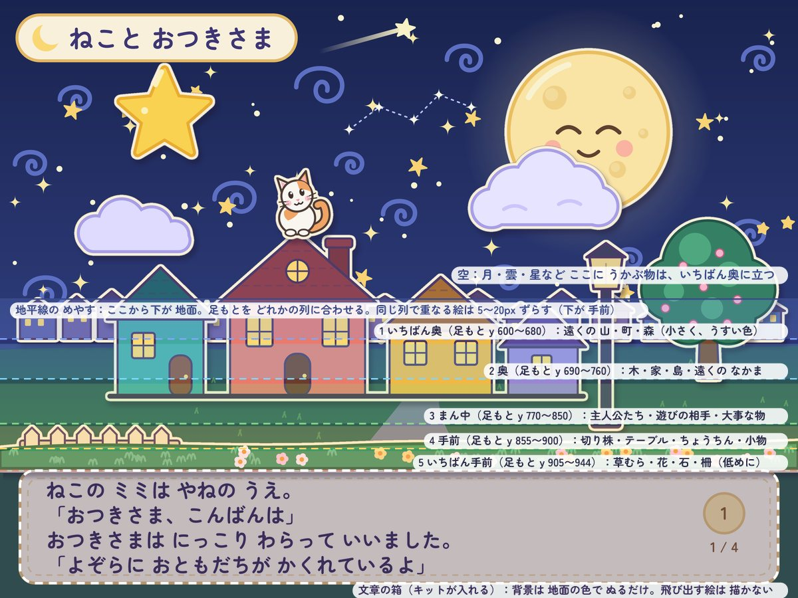

# 09 自分の絵に描きかえる

Claude で作った絵本（または見本）の絵を、**自分で描いた絵** に入れかえる方法です（作りかた ②）。
動き・しかけ・文章は そのままで、絵だけが 自分の絵になります。ぜんぶでも、1ページだけ・1つの絵だけでも入れかえられます。

描くアプリに合わせて、2つの形が あります。

| 描くアプリ | 絵のファイル | 下絵セット |
|---|---|---|
| お絵かきアプリ（Procreate・CLIP STUDIO PAINT・アイビスペイント など） | **PNG**（2400×1800） | `<名前>_png.zip`（`npm run png`） |
| ベクターアプリ（Illustrator・Inkscape・Affinity Designer・Figma など） | **SVG**（1600×1200） | `<名前>_svg.zip`（`npm run svg`） |

プログラムは書きません。Claude に頼めば、パソコンがなくても（iPad などで描いて）できます。

## おすすめの順番

| | すること | どこで |
|---|---|---|
| 1 | Claude で絵本を作る（「絵は あとで 自分の絵に 描きかえる（PNG か SVG）」と伝える） | Claude |
| 2 | 動き・しかけ・絵の分けかたを **先に決めきる** | Claude の チャットの中の プレビュー |
| 3 | 下絵セットをもらう | Claude（パソコンなら `npm run png`・`npm run svg`） |
| 4 | 描いて、PNG か SVG で書き出す | iPad・パソコン など |
| 5 | 描いた絵に 差しかえる | Claude（パソコンなら `npm run put-png`） |
| 6 | 確かめて、公開し直し・印刷し直し | GitHub・プリンター |

> **なぜ この順番？** 絵本の絵は「1つの飛び出す絵 = 1つのファイル」に分かれていて、さわると動く・かくれる・切りかわる などの しかけは、ファイルごとに決まっています。先に動きと しかけを決めきってから描くと、描きなおしが いりません。

## 1. Claude で作る

- キット（`pulapulabo-ehon-maker.zip`）を Claude に添付して作ります（キットの中の `つかいかた.md`、または GitHub のページの「① Claude で作る」）
- 決めかたの質問の「絵の作りかた」で **「あとで 自分の絵に 描きかえる（PNG）」か「（SVG）」** を選ぶか、依頼文に そう書きます。できあがりと一緒に、下絵セットも届きます
- Claude が描いた絵は、位置と大きさを決めるための「仮の絵」と考えて大丈夫です

## 2. 動き・しかけを 決めきる

- できあがると、Claude の チャットの中に「＜題名＞ — カメラなしプレビュー」の カード（アーティファクト）が出ます。開いて 全ページを遊んでみます（カードが出ないときは、届いた `<名前>_preview.html` を開きます）
- 直したいところは、**描く前に** Claude に頼みます
  - 動き・遊び・しかけ・ページ数・登場人物の数
  - **絵の分けかた**（どれが別々に動くか）。例：「木と ふくろうを 別の絵に」「ドアを ひらく絵にして」「左右の すすきを 別の絵に」
  - 絵の位置・大きさ・奥行きの列（「ねこを もっと大きく」「木を いちばん奥の列へ」）
- 文章やセリフは あとで変えても、描きなおしは いりません

## 3. 下絵セットをもらう

- Claude に「下絵の PNG をください」（ベクターアプリなら「下絵の SVG をください」）と頼みます。1ページだけなら「2ページめの 下絵の PNG をください」
- 自分のパソコンなら `npm run png`・`npm run svg`（下の「自分のパソコンで」）

```
<名前>_png/（または <名前>_svg/）
  はじめに読んでね.txt   どのファイルが何の絵か（背景・飛び出す絵・かくれている絵・表情・足もとの列 など）と描きかた
  _ガイド.png            奥行きの5列と文章の箱（SVG セットには _ガイド.svg も）。描くときに 重ねて使う
  p1/                    1ページめ
    _下絵.png            このページの見え方（ぜんぶ重ねた絵）。描くときの下じき
    _background.png      背景（紙に残る絵）            ← SVG セットでは .svg
    cat.png              飛び出す絵（1つずつ）
    cat@happy.png        cat の笑顔（クリアしたとき）
    moon@awake.png       さわると切りかわる絵
    …
  p2/ …
  cover.png              表紙の絵
  cast/cat.png           はじめる画面に出す登場人物の絵
  items/net.png          もちものの絵
```

- PNG セット：ページの絵は 2400×1800、表紙は 2400×1404
- SVG セット：ページの絵は 1600×1200（いまの SVG を そのまま）。もともと PNG の絵は PNG のまま入ります



## 4. 描く

### 描くときの きまり（PNG・SVG どちらも）

- **足もと：** 地面に立つ物は、いちばん下の端を 下絵と同じ高さにします（そこが 立ち上がるときの折り目）。何かに乗っている物は、乗せている物の 上の端に合わせます
- **奥行き：** 足もとを、`_ガイド` の **5つの列**（いちばん奥・奥・まん中・手前・いちばん手前）の どれかに置きます。同じ列で となりと重なる絵は、足もとを 少し（PNG なら 8〜30px、SVG なら 5〜20px）ずらします（下に ある方が 手前に立つ）。くわしくは [03 絵を用意する の「奥行き」](03_絵を用意する.md)
- **文章の箱：** 下の約5分の1（PNG なら 上から 1416、SVG なら 944 より下）には 文章の箱が入ります。背景は そこを 色で塗るだけ、飛び出す絵は そこに描きません
- **背景：** こまかい模様（草・星・木目・水玉 など）を入れ、広い1色の面を作りません。ページごとに はっきり ちがう背景にします（カメラは 背景のちがいで ページを見分けます）
- **かくれている絵：** はじめは見えない絵（さがす遊び など）。かくれる場所（木のうしろ など）の位置に描きます
- **切りかえの絵**（`moon@awake` など）・**表情の絵**（`cat@happy` など）：元の絵と同じ位置・同じ大きさで、変わるところ（顔・ドア など）だけ変えます
- **表情の絵：** 新しい絵の登場人物は、笑顔（`@happy`）・まばたき（`@blink`）・しゃべる口（`@talk`）を描くと使われます。描かなくても絵本は動きます（笑顔・まばたき・口パクが出ないだけ）。SVG で、目の黒いところに `class="eye"`、口に `class="mouth"` を付けると 自動でできます（[03 の「顔のパーツ」](03_絵を用意する.md)）
- 白いふちどりと影は、キットが自動で付けるので描きません
- 線は太め、色は はっきりと（スマホに小さく映っても見えるように）

### A. お絵かきアプリ（PNG）

1. 2400×1800 のキャンバスを作ります（または、描きかえたい PNG を そのまま開きます）
2. そのページの `_下絵.png` を いちばん下のレイヤーに読みこみ、不透明度を 30% くらいにします。`_ガイド.png` を いちばん上に重ねると、列と文章の箱が見えます
3. **1つの絵 = 1つのレイヤー** で描きます。レイヤーの名前を ファイル名と同じ（`cat`、`moon@awake` など）にしておくと、書き出すときに迷いません
4. 書き出す：その絵のレイヤーだけを表示して（**下絵・ガイド・背景のレイヤーは かくす**）、**キャンバスの大きさのまま**（切り抜かない）、**まわりは透明のまま** PNG で書き出します。名前は、もらった PNG と同じにします（`cat.png`）。`_background.png` だけは 透明にしなくて OK です
   - **Procreate：** ［アクション］→［共有］→［レイヤーを共有］→［PNG ファイル］で、表示しているレイヤーが1枚ずつ書き出されます。名前が「作品名-1」などになるので、ファイルアプリで名前を変えます
   - **CLIP STUDIO PAINT：** 書き出すレイヤーだけを表示し（用紙レイヤーも非表示）、［ファイル］→［画像を統合して書き出し］→［.png］
   - **アイビスペイント：** 書き出すレイヤーだけを表示して、透過 PNG で保存します
   - くわしくは [03 絵を用意する の「A. PNG」](03_絵を用意する.md)

### B. ベクターアプリ（SVG）

1. 描きかえたい SVG（`cat.svg` など）を そのまま開きます。新しく描くときは、アートボード（キャンバス）を **1600×1200 px** にします
2. そのページの `_下絵.png` を いちばん下に置き（左上 0,0・大きさ 1600×1200）、うすくして ロックします。`_ガイド.svg` も いちばん上に置いて ロックします
   - **Illustrator：** 下絵を 配置して、レイヤーを「テンプレート」にします
   - **Inkscape：** ［ファイル］→［インポート］で 下絵を読みこみ、不透明度を下げて ロックします
3. 1つのファイル = 1つの絵。位置と大きさは下絵に合わせます
4. 書き出す：下絵とガイドを かくして（または 消して）、**アートボード全体** を SVG で書き出します（選んだ物だけを書き出すと 切り抜かれて、4:3 で なくなります）。名前は、もらった SVG と同じにします（`cat.svg`）
   - 文字は アウトライン化（図形に）します。そのままの文字は Zen Maru Gothic で表示されます
   - 画像は「リンク」にせず、使うなら「埋め込み」にします
   - **Illustrator：** ［ファイル］→［書き出し］→［スクリーン用に書き出し］か［書き出し形式］で SVG（アートボードを使用）
   - **Inkscape：** ［ファイル］→［コピーを保存］→ プレーン SVG（ページ全体）

### 少しずつでも OK

- 1ページだけ・主人公だけでも入れかえられます。描いていない絵は Claude の絵のまま使われます（PNG と SVG は まぜられます）
- まず1つ描いて差しかえ、プレビューで位置を確かめてから続きを描くと安心です

## 5. 差しかえる

### Claude で

1. 描いた絵を、もらったときと同じ フォルダ分け（`p1/`・`p2/` …）のまま、1つの ZIP にまとめます
   - 描いていないファイルが まざっていても大丈夫です（同じ絵のままのものは、そのまま使われます）
   - フォルダ分けが むずかしいときは、ファイル名を `p1_cat.png`（`p1_cat.svg`）のように「ページ_名前」にします
2. 同じチャットなら、ZIP を添付して「この絵に差しかえてください」と送ります
   別のチャットなら、キット（`pulapulabo-ehon-maker.zip`）・`<名前>_source.zip`・描いた絵の ZIP の **3つ** を添付して頼みます
3. チャットの中に 新しい プレビューが出て、新しい `<名前>_github.zip`・`<名前>_source.zip`・印刷用 PDF が届きます

### 自分のパソコンで

Claude に頼まずに、自分のパソコンで 下絵を作ったり 入れかえたり することもできます。**最初に1回、準備がいります**（③ と同じ。くわしくは [01 はじめかた](01_はじめかた.md) の 1〜4）。

1. [Node.js](https://nodejs.org/)（20 以上。「LTS」の方）と [VS Code](https://code.visualstudio.com/) を入れます
2. `pulapulabo-ehon-maker.zip` を展開し、そのフォルダを VS Code で開きます（**ファイル → フォルダーを開く**）
3. **ターミナル → 新しいターミナル** を開き、`npm install` を打ちます（1〜2分）
4. Claude からもらった `<名前>_source.zip` を、キットの `books/` フォルダの中に展開します（`books/<名前>/book.json` ができればOK）
5. `npm run use -- <名前>` を打ちます（これから この絵本を作る、という意味）

準備ができたら：

```
npm run png                                  ← お絵かきアプリ用の下絵（out/<名前>_png/）
npm run svg                                  ← ベクターアプリ用の下絵（out/<名前>_svg/）
（描く）
npm run put-png -- 描いた絵のフォルダ          ← PNG も SVG も（npm run put-svg も同じ）
npm run check
npm run build                                ← publish/<名前>/preview.html をダブルクリックで確かめる
npm run pack                                 ← GitHub に上げる ZIP などを作る
```

- `npm run put-png -- 描いた絵のフォルダ --dry` で、何が入れかわるかだけを先に見られます
- 前の絵は `books/<名前>/old-pictures/` に残ります（もとに戻すときは、そこから戻して、新しい絵を消します）
- できた `out/<名前>_source.zip` を Claude に渡せば、続きを Claude に頼むこともできます

### put-png がすること

- 同じ名前の絵と入れかえます（`p1/cat.png` → `pages/p1/layers/cat.png`。前の `cat.svg` は old-pictures へ。SVG も同じ）
- 前と同じ絵（描いていない絵）は、そのままにします
- 新しい絵の登場人物の、表情ツールが前の絵から作った表情（`@blink`・`@talk` など）は、合わなくなるので はずします（SVG で 目と口に class が あれば、作るときに 新しい絵から 作りなおします）
- 名前がちがう・4:3 でない・まわりが透明でない・外の画像を読みこんでいる 絵は入れずに、理由を出します

## 6. 確かめて、公開し直す・印刷し直す

- プレビューで：足もとが浮いていない、文章の箱に重なっていない、切りかえの絵や表情の絵が ずれていない
- GitHub に上げ直します（`<名前>_github.zip` の中身を **Add file → Upload files**。[06 公開と印刷](06_公開と印刷.md)）
- **背景・見えている飛び出す絵・表紙を描きかえたら、印刷し直します。** カメラは 印刷した絵で ページを見分けるので、古い紙では見分けられなくなります

## うまくいかないとき

| 出てきたこと | なおしかた |
|---|---|
| 「縦横の比が 4:3 ではありません」 | 切り抜かれて書き出されています。キャンバス（アートボード）の大きさのまま書き出します |
| 「まわりが透明になっていません」 | 背景・用紙・下絵のレイヤーを かくしてから書き出します |
| 「…という絵は この絵本にありません」 | ファイル名を「はじめに読んでね.txt」の名前にします（アプリが付けた「作品名-1」などは変えます） |
| 「どのページの絵か わかりません」 | `p1/` のような フォルダに入れるか、`p1_cat.png` のような名前にします |
| 「外の画像ファイル…を読みこんでいます」 | SVG の中の画像を「埋め込み」にするか、その絵は PNG で書き出します |
| 絵が浮く・ずれる | 下絵に合わせて、足もとの高さを直して書き出し直します |
| カメラが ページを見分けにくくなった | 背景に こまかい模様を足し、ページどうしを ちがう色・模様にして、印刷し直します |
| 笑わない・まばたきしない | `cat@happy`・`cat@blink`・`cat@talk` を描きます（SVG なら 目と口に class） |
| `npm` が見つからない | 準備（Node.js を入れる）が まだです。入れたあと VS Code を開き直します（[07 困ったとき](07_困ったとき.md)） |
